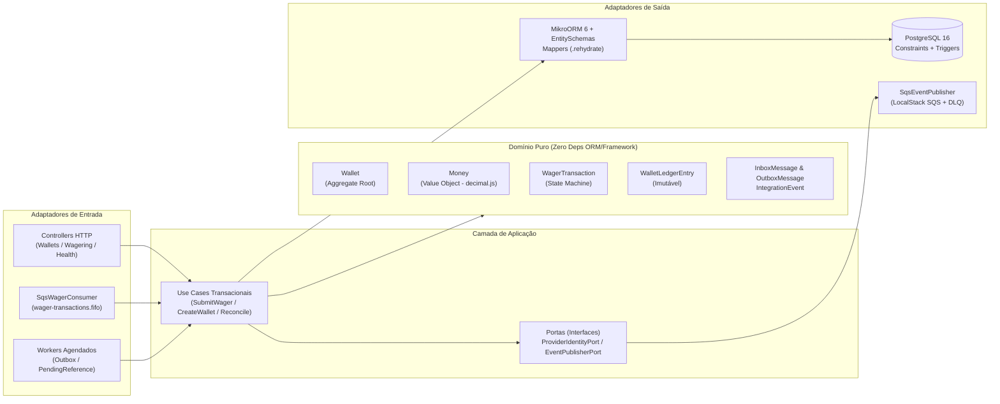

# ARCHITECTURE.md — Distributed Wagering Processor

Este documento descreve e justifica as decisões arquiteturais, estratégias de controle de concorrência, modelagem financeira, desenho do schema relacional, garantias de idempotência, mensageria transacional e resultados experimentais de carga do **Distributed Wagering Processor**.

---

## 1. Visão Geral da Arquitetura (DDD + Arquitetura Hexagonal)

O serviço foi estruturado aplicando **Domain-Driven Design (DDD)** e **Ports & Adapters (Arquitetura Hexagonal)** sobre **NestJS** e **Bun 1.x**, isolando rigorosamente as invariantes financeiras de detalhes de infraestrutura:



### Separação Estrita entre Domínio e Persistência
- **Zero Acoplamento no Domínio:** Nenhuma classe em `src/domain/**` importa decorators do `@nestjs/*` ou `@mikro-orm/*`.
- **Encapsulamento e Factories Estáticas:** Todas as entidades e objetos de valor (`Money`, `Wallet`, `WagerTransaction`, `WalletLedgerEntry`, `InboxMessage`, `OutboxMessage`) possuem construtor `private` e só podem ser instanciadas via factories de criação (`Money.from`, `Wallet.open`, `WagerTransaction.create`, `WalletLedgerEntry.create`) — que validam todas as pré-condições — ou via `rehydrate()` quando reconstruídas a partir do banco de dados pelos `DomainMappers`, sem reexecutar regras de transição de criação.

---

## 2. Escolha do ORM (MikroORM) e Estratégia Transacional

### Por que MikroORM?
Escolhemos o **MikroORM 6 (`@mikro-orm/postgresql`)** pelos seguintes motivos técnicos:
1. **Unit of Work e Identity Map Explícitos:** O `EntityManager.transactional(async (txEm) => ...)` garante que todas as operações de leitura com lock e escrita participem da mesma transação física do PostgreSQL (`BEGIN ... COMMIT / ROLLBACK`), fazendo fork do contexto para evitar vazamento de estado entre requisições concorrentes.
2. **Desacoplamento via `EntitySchema`:** O recurso `EntitySchema` do MikroORM permite mapear classes de persistência (`WalletOrmEntity`, `WagerTransactionOrmEntity`, etc.) sem poluir as entidades de domínio com `@Entity()` ou `@Property()`.
3. **Suporte Nativo a `LockMode.PESSIMISTIC_WRITE`:** Permite emitir `SELECT ... FOR UPDATE` diretamente na leitura do agregado.

### Atomicidade Transacional (All-or-Nothing)
Em qualquer operação de aposta (`SubmitWagerTransactionUseCase`), uma única transação SQL engloba:
1. Registro/verificação da `InboxMessage` (quando originada do consumer SQS);
2. Atualização do saldo e incremento da `version` na `Wallet` (`wallets`);
3. Persistência da `WagerTransaction` (`wager_transactions`) com seu status resultante e o snapshot do saldo observado (`observed_balance_amount`);
4. Inserção do lançamento imutável `WalletLedgerEntry` (`wallet_ledger_entries`), quando há alteração de saldo;
5. Enfileiramento dos eventos de integração (`WagerTransactionProcessed`, `WagerTransactionRejected`, `WagerTransactionPendingReference`, `WalletBalanceChanged`) na tabela `outbox_messages`.

Nenhum evento é publicado na fila externa antes da confirmação (`COMMIT`) dessa transação no PostgreSQL.

---

## 3. Representação e Mapeamento de `Money`

- **Em Memória (`Money` Value Object):** Utiliza `decimal.js` com precisão arbitrária e escala fixa de **2 casas decimais**. Jamais utilizamos `number`, `float` ou `double` para valores monetários.
- **Validações de Contrato de Entrada (`Money.from`):** Rejeita `NaN`, `Infinity`, notação científica (`1e2`), strings vazias, valores negativos, mais de 2 casas decimais (`"25.123"`) e códigos de moeda fora do padrão ISO-4217 (`/^[A-Z]{3}$/`).
- **Arredondamento:** Cálculos intermediários que exijam arredondamento explícito (`Money.fromUnscaledDecimal`) utilizam *Banker's Rounding* (`Decimal.ROUND_HALF_EVEN`).
- **Na Persistência (PostgreSQL):** Valor e moeda são armazenados em colunas separadas: `NUMERIC(18, 2) NOT NULL` e `VARCHAR(3) NOT NULL`. O driver do PostgreSQL retorna colunas `NUMERIC` como `string` exata, que é reidratada via `Money.rehydrate({ amount, currency })` sem conversão intermediária para `number`.

---

## 4. Controle de Concorrência por `walletId`

### Estratégia Adotada: Pessimistic Write Lock por Linha (`SELECT ... FOR UPDATE`) + Versionamento + Constraints SQL

A unidade de concorrência do sistema é a `walletId`. Adotamos **Pessimistic Row-Level Locking (`LockMode.PESSIMISTIC_WRITE` / `SELECT ... FOR UPDATE`)** na linha da tabela `wallets` combinada com incremento explícito de `version` e constraint `CHECK (balance_amount >= 0)` no PostgreSQL.

#### Justificativa Técnica e Trade-off vs. Optimistic Locking Puro:
- **Contenção em "Hot Wallets":** Em plataformas de iGaming, uma mesma carteira frequentemente recebe rajadas simultâneas (apostas rápidas em slots, múltiplos provedores liquidando rodadas paralelas ou retentativas de rede).
- **O problema do Optimistic Locking puro sob contenção alta:** Se 50 requisições concorrentes atingirem a mesma carteira usando apenas `UPDATE wallets SET ... WHERE id = $1 AND version = $2`, 1 requisição terá sucesso e **49 sofrerão conflito de versão**, exigindo abortar a transação SQL e reexecutar dezenas de ciclos de retry na aplicação (efeito *thundering herd*).
- **A vantagem do `SELECT ... FOR UPDATE` por `walletId`:**
  1. O lock é adquirido **exclusivamente na linha da `walletId` alvo** — carteiras de jogadores distintos são processadas **100% em paralelo** sem qualquer lock global.
  2. Quando duas apostas de `80.00 BRL` disputam um saldo de `100.00 BRL` em instâncias diferentes da aplicação, o PostgreSQL serializa as duas transações na fila de lock da linha da carteira em microssegundos: a primeira debita `80.00 BRL` (deixando `20.00 BRL`, `version = 2`) e faz `COMMIT`; a segunda lê imediatamente o estado pós-commit (`20.00 BRL`), constata saldo insuficiente e grava a transação como `REJECTED` (`INSUFFICIENT_FUNDS`, mantendo `version = 2`).
  3. **Ordem de Aquisição de Locks (Prevenção de Deadlocks):** Toda transação financeira adquire o lock sempre na mesma hierarquia determinística: `Wallet` (`wallets`) $\rightarrow$ `WagerTransaction` (`wager_transactions`). Além disso, o caso de uso conta com retry automático com backoff exponencial caso o PostgreSQL sinalize `40001` (*serialization failure*) ou `40P01` (*deadlock detected*).

---

## 5. Desenho do Schema e Garantias no Banco de Dados

As invariantes de negócio não dependem apenas do código TypeScript; elas são impostas estruturalmente pelo PostgreSQL na migration `Migration202610190001_InitialSchema`:

1. **Tabela `wallets`:**
   - `CONSTRAINT uq_wallets_player_currency UNIQUE (player_id, currency)`: garante no máximo uma carteira por jogador e moeda.
   - `CONSTRAINT chk_wallets_balance_non_negative CHECK (balance_amount >= 0)`: torna fisicamente impossível persistir saldo negativo.
   - `CONSTRAINT chk_wallets_version_positive CHECK (version >= 1)`: garante integridade do versionamento.

2. **Tabela `wager_transactions`:**
   - `CONSTRAINT uq_wager_tx_idempotency_key UNIQUE (idempotency_key)`: garante deduplicação global por chave de idempotência.
   - `CONSTRAINT uq_wager_tx_provider_ext_id UNIQUE (provider_id, external_transaction_id)`: impede duplicidade de ID externo no mesmo provedor.
   - **Índice Parcial Único (`uq_wager_tx_processed_reversal_per_ref`):**
     ```sql
     CREATE UNIQUE INDEX uq_wager_tx_processed_reversal_per_ref
     ON wager_transactions (reference_transaction_id)
     WHERE status = 'PROCESSED' AND kind IN ('REFUND', 'ROLLBACK');
     ```
     Impede no nível do SGBD que uma mesma transação referenciada seja revertida com sucesso (`PROCESSED`) mais de uma vez, enquanto permite que tentativas subsequentes sejam registradas como `REJECTED` (`REFERENCE_ALREADY_REVERSED`) para fins de auditoria.

3. **Tabela `wallet_ledger_entries` (Append-Only & Aritmeticamente Verificada):**
   - `CONSTRAINT uq_ledger_wallet_transaction UNIQUE (wallet_id, transaction_id)`: garante que uma transação financeira produza no máximo 1 lançamento por carteira.
   - `CONSTRAINT chk_ledger_amount_positive CHECK (amount > 0)` e `CONSTRAINT chk_ledger_balances_non_negative CHECK (balance_before >= 0 AND balance_after >= 0)`.
   - `CONSTRAINT chk_ledger_arithmetic`:
     ```sql
     CHECK (
       (direction = 'CREDIT' AND balance_after = balance_before + amount)
       OR (direction = 'DEBIT' AND balance_after = balance_before - amount)
     )
     ```
   - **Trigger de Imutabilidade (`trg_wallet_ledger_immutable`):**
     Uma função `plpgsql` (`prevent_wallet_ledger_mutation()`) associada a um trigger `BEFORE UPDATE OR DELETE ON wallet_ledger_entries` rejeita com erro de integridade qualquer tentativa de sobrescrever ou excluir lançamentos do ledger.

---

## 6. Idempotência Persistente e Algoritmo de `payloadHash`

### Cálculo do `payloadHash`
O `payloadHash` é calculado em `src/domain/shared/canonical-hash.ts` usando **SHA-256** sobre a representação JSON canônica (chaves ordenadas lexicograficamente de forma recursiva, omitindo chaves `undefined`/`null`) exclusivamente do subconjunto de campos de negócio:
- `providerId`, `externalTransactionId`, `playerId`, `walletId`, `roundId`, `gameId`, `kind`, `money: { amount, currency }` e `referenceExternalTransactionId`.
- Metadados de transporte (headers HTTP, `Idempotency-Key`, `messageId` do SQS, `correlationId`, `occurredAt`) **não** entram no hash.

### Comportamento em Replays e Corridas Concorrentes
- **Replay Idêntico (`idempotencyKey` igual + `payloadHash` igual):** Retorna o status original e o **saldo exato observado no momento em que a transação original foi processada** (`observed_balance_amount`), com `idempotentReplay: true`, sem reexecutar efeitos colaterais.
- **Conflito de Payload (`idempotencyKey` igual + `payloadHash` divergente):** Lança `IdempotencyConflictError`, mapeado para HTTP `409 Conflict` (`IDEMPOTENCY_CONFLICT`).
- **50 Requisições Idênticas em Paralelo:** Ao adquirir `SELECT ... FOR UPDATE` na `Wallet` antes da verificação final de idempotência em isolamento `READ COMMITTED`, a 1ª transação insere e faz commit; as 49 transações seguintes enxergam imediatamente o registro confirmado ao adquirir o lock (ou capturam o código SQL `23505` em caso de corrida antes do lock) e retornam `idempotentReplay: true`.

---

## 7. Referências Fora de Ordem (`PENDING_REFERENCE`) e Taxonomia de `FailureCode`

### Reprocessamento de `PENDING_REFERENCE`
Quando um `REFUND` ou `ROLLBACK` chega antes da transação referenciada:
1. A transação é persistida com `status = 'PENDING_REFERENCE'`, `retry_count = 0` e `next_retry_at = now + 200ms`, emitindo o evento `WagerTransactionPendingReference` na outbox e respondendo HTTP `202 Accepted`.
2. O worker `ProcessPendingReferencesUseCase` busca registros vencidos usando `SELECT ... FOR UPDATE SKIP LOCKED` com backoff exponencial ($200\text{ms} \times 2^{\text{attempt}}$).
3. Assim que a transação referenciada se torna `PROCESSED`, o worker aplica a movimentação na carteira sob lock pessimista e transiciona a operação para `PROCESSED`.
4. **Limite de Tentativas (TTL):** Após esgotar `PENDING_REF_MAX_ATTEMPTS` (padrão: `5` tentativas), a transação transiciona para o estado terminal `REJECTED` com `failureCode = "REFERENCE_NOT_FOUND"` e publica `WagerTransactionRejected`.

### Taxonomia de `FailureCode`

| `FailureCode` | Significado Operacional |
|---|---|
| `INSUFFICIENT_FUNDS` | Aposta (`BET`) rejeitada por saldo insuficiente na carteira |
| `NEGATIVE_BALANCE_ON_REVERSAL` | `ROLLBACK` de um crédito (`WIN` ou `REFUND`) rejeitado porque deixaria o saldo da carteira negativo (distinto de `INSUFFICIENT_FUNDS`) |
| `CURRENCY_MISMATCH` | Moeda da operação difere da moeda da carteira ou da transação referenciada |
| `REFERENCE_NOT_FOUND` | Transação referenciada não chegou dentro do limite de tentativas do `PENDING_REFERENCE` (ou `WIN` referenciando aposta inexistente) |
| `INVALID_REFERENCE_KIND` | `REFUND` referenciando transação que não é `BET`, ou `ROLLBACK` referenciando tipo inválido |
| `REFERENCE_NOT_PROCESSED` | Transação referenciada encontra-se em estado `REJECTED` ou `FAILED` |
| `REFERENCE_CONTEXT_MISMATCH` | Referência pertence a outro `providerId`, `playerId`, `walletId` ou `roundId` |
| `REFERENCE_AMOUNT_MISMATCH` | Valor do `REFUND` ou `ROLLBACK` difere do valor original da referência |
| `REFERENCE_ALREADY_REVERSED` | A transação referenciada já foi revertida anteriormente por um `REFUND` ou `ROLLBACK` |
| `WIN_REFERENCE_INVALID` | `WIN` informou uma referência que não corresponde a uma `BET` |
| `PERMANENT_INFRASTRUCTURE_FAILURE` | Falha permanente auditável registrada em estado `FAILED` |

---

## 8. Mensageria SQS, Transactional Inbox/Outbox e Graceful Shutdown

### Consumidor SQS (`SqsWagerConsumer`)
- Reutiliza o mesmo `SubmitWagerTransactionUseCase` da camada HTTP.
- **Inbox Persistente:** Deduplica mensagens na tabela `inbox_messages` pela chave composta `(consumer_name, message_id)` dentro da mesma transação SQL que altera o saldo.
- **ACK Pós-Commit:** O `DeleteMessageCommand` só é enviado ao SQS após o `COMMIT` da transação no PostgreSQL. Se o processo morrer entre o commit e o ACK, a mensagem reentregue pelo SQS é absorvida de forma idempotente pela `inbox_messages` / `wager_transactions`.
- **Classificação de Falhas e DLQ:**
  - *Rejeições de negócio (`REJECTED`):* Estado terminal persistido no banco $\rightarrow$ ACK imediato na fila.
  - *Erros transitórios (banco indisponível / timeout):* Altera `VisibilityTimeout` com backoff exponencial ($2^{\text{receiveCount}}$ segundos). Ao atingir `maxReceiveCount` (3), encaminha para `wager-transactions-dlq.fifo`.
  - *Mensagens corrompidas / contrato inválido:* Movidas imediatamente para `wager-transactions-dlq.fifo` com atributo `FailureReason` e contabilizadas na métrica `dlqMessagesTotal`.
- **Graceful Shutdown (`SIGTERM`):** Ao receber `SIGTERM`, o consumer interrompe a busca de novas mensagens, aguarda a conclusão das mensagens em voo (*in-flight*) dentro do *grace period* e, caso alguma ainda reste pendente no encerramento, executa `ChangeMessageVisibilityCommand(VisibilityTimeout = 0)` para devolvê-la imediatamente a outra instância.

### Transactional Outbox (`PublishOutboxUseCase`)
- Múltiplas instâncias publicam eventos da tabela `outbox_messages` concorrentemente utilizando:
  ```sql
  SELECT ... FROM outbox_messages
  WHERE published_at IS NULL AND (next_attempt_at IS NULL OR next_attempt_at <= NOW())
  ORDER BY occurred_at ASC
  LIMIT 50
  FOR UPDATE SKIP LOCKED
  ```
- A cláusula `FOR UPDATE SKIP LOCKED` garante que diferentes workers processem lotes disjuntos em paralelo sem bloqueio mútuo.
- Os eventos são publicados na fila `integration-events.fifo` com `MessageGroupId = aggregateId` (`walletId`) e `MessageDeduplicationId = eventId`.

---

## 9. Autenticação e Integração com Identity Provider

### Decisão de Escopo
Para manter o `docker-compose.yml` leve e focado no caminho crítico de consistência financeira e mensageria (evitando o overhead de memória e tempo de boot de um container Keycloak/Zitadel local durante as suítes de integração), implementamos **o ponto de extensão explícito no código**:
- Porta de domínio/aplicação: `ProviderIdentityPort` (`src/application/ports/provider-identity.port.ts`);
- Adaptador configurável: `ConfigurableProviderIdentityAdapter` (`src/infrastructure/auth/configurable-provider-identity.adapter.ts`);
- Guard HTTP: `ProviderAuthGuard` (`src/presentation/http/guards/provider-auth.guard.ts`) aplicado aos controllers de `wallets` e `wagering`, mantendo `/health/live`, `/health/ready` e `/metrics` abertos.

### Desenho de Produção com Keycloak / Zitadel (OAuth2 Client Credentials M2M)
Em ambiente de produção para integração Server-to-Server com provedores de jogos:
1. **Fluxo OAuth 2.0 Client Credentials (`grant_type=client_credentials`):** Cada provedor de jogo (`provider-a`, `pragmatic`, `evolution`) possui um `client_id` e `client_secret` (ou chave privada via `private_key_jwt` RFC 7523) provisionados no **Keycloak** ou **Zitadel**.
2. **Emissão de JWT Assinado (RS256 / EdDSA):** O IdP emite um Access Token de curta duração (ex.: 5–15 min) contendo a claim customizada `"provider_id": "provider-a"` e escopo `"wagering:write"`.
3. **Validação Local via JWKS + Prevenção de Spoofing:** O adaptador concreto de `ProviderIdentityPort` valida a assinatura do JWT localmente usando o endpoint **JWKS (`/.well-known/jwks.json`)** cacheado em memória com rotação automática por `kid`, e verifica a invariante de autorização: `jwt.claims.provider_id === request.body.providerId`, impedindo que o Provedor A envie transações em nome do Provedor B.

---

## 10. Relatório do Teste de Carga (`bun run test:load`)

Implementamos o script `test/load/load-test.ts` (exposto via `bun run test:load`) para avaliar o comportamento sob contenção real em múltiplas instâncias.

### Ambiente e Metodologia
- **Topologia:** **3 instâncias independentes** da aplicação NestJS rodando simultaneamente sobre **Bun 1.4.3** em Linux, conectadas a **PostgreSQL 16** e **LocalStack 3.7 (SQS)** em containers Docker reais.
- **Carga de Trabalho:** **600 requisições HTTP** disparadas em ondas de **40 requisições simultâneas (`concurrency = 40`)** distribuídas em *round-robin* entre as 3 instâncias:
  - 20 carteiras ativas, sendo **2 "Hot Wallets"** concentrando 33% de todo o tráfego simultâneo para forçar contenção real de lock por linha (`SELECT ... FOR UPDATE`);
  - Mix de operações `BET` (75%) e `WIN` (25%);
  - **10% de replays idempotentes** injetados concorrentemente com a mesma `Idempotency-Key`.

### Resultados Obtidos

| Métrica | Resultado Observado |
|---|---|
| **Total de Requisições** | `600` |
| **Concorrência Simultânea** | `40` requests em paralelo em `3` instâncias |
| **Duração Total** | `3.43 s` |
| **Throughput Médio** | **`175.05 RPS`** (transações financeiras completas com Outbox) |
| **Latência `p50` (Mediana)** | **`119.94 ms`** |
| **Latência `p95`** | **`343.25 ms`** |
| **Latência `p99`** | **`510.33 ms`** |
| **Taxa de Erro (`5xx`)** | **`0.00%`** (`600/600` respostas HTTP `200 OK`) |
| **Replays Idempotentes Detectados** | `60` (100% das duplicatas injetadas) |
| **Eventos Publicados pela Outbox** | `1.120+` eventos drenados com `remainingUnpublished = 0` |
| **Invariante Final (`wallet.balance == ledger`)** | **`true` em 100% das 20 carteiras** |

### Análise Crítica dos Resultados
- A diferença entre `p50` (`119.94 ms`) e `p99` (`510.33 ms`) reflete diretamente o enfileiramento intencional do `SELECT ... FOR UPDATE` nas duas *Hot Wallets*: enquanto as 18 carteiras normais respondem abaixo de `120 ms`, as requisições que disputam simultaneamente a mesma *Hot Wallet* aguardam na fila de lock de linha do PostgreSQL sem gerar erros `500` e sem perder atualizações (*zero lost updates*).

---

## 11. Trade-offs e Limitações Conhecidas

1. **Outbox via Polling (`SKIP LOCKED`) vs. Log-Based CDC (Debezium / Logical Replication):**
   - *Escolha atual:* Polling com `FOR UPDATE SKIP LOCKED` a cada `200ms`. É simples, autossuficiente e não exige infraestrutura adicional de Kafka Connect.
   - *Limitação e evolução:* Sob dezenas de milhares de RPS, o polling adiciona leituras periódicas ao banco. Em escala global, a evolução natural é ler o WAL do PostgreSQL via *Logical Replication / Debezium*.
2. **Crescimento das Tabelas `wallet_ledger_entries`, `inbox_messages` e `outbox_messages`:**
   - *Limitação:* Tabelas append-only crescem continuamente.
   - *Evolução:* Particionamento declarativo do PostgreSQL (`PARTITION BY RANGE (created_at)`) mensal/semanal para `wallet_ledger_entries` e política de expurgo/arquivamento em S3 (Parquet) para registros de `inbox_messages` e `outbox_messages` já processados/publicados há mais de 30 dias.
3. **Reconciliação de Carteiras com Histórico Muito Longo:**
   - *Limitação:* `POST /wallets/:walletId/reconciliation` soma todos os lançamentos desde a abertura da carteira ($O(N)$ lançamentos).
   - *Evolução:* Introduzir *Periodic Balance Snapshots* (checkpoints diários/mensais assinados do ledger), permitindo reconciliar a partir do último snapshot validado.

